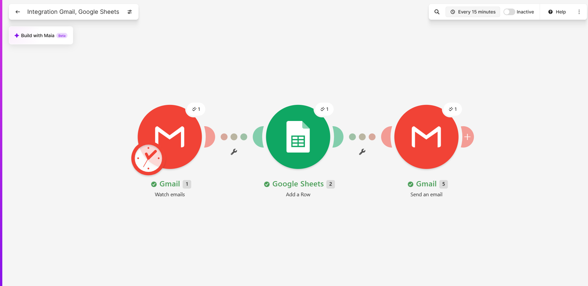

## Flujo: Registro de Pedidos Entrantes y Notificación

**Herramienta**: Make

**Disparador (Trigger)**:
- Aplicación: Gmail
- Evento: "Nuevo email recibido" con asunto que contiene "Nuevo pedido"

**Pasos del flujo**:
1. ACCIÓN: Google Sheets → Agregar fila
   - Columna "Fecha": {{ timestamp }}
   - Columna "Asunto": {{ email.subject }}

2. ACCIÓN: Gmail → Enviar email
   - Para: angel.avila@up.ac.pa
   - Asunto: "Procesado: {{ email.subject }}"

**Captura de pantalla del flujo en la herramienta**:

**Declaración de uso de IA**: Se utilizó asistencia de IA únicamente para estructurar y verificar el formato Markdown de acuerdo a la plantilla solicitada.
